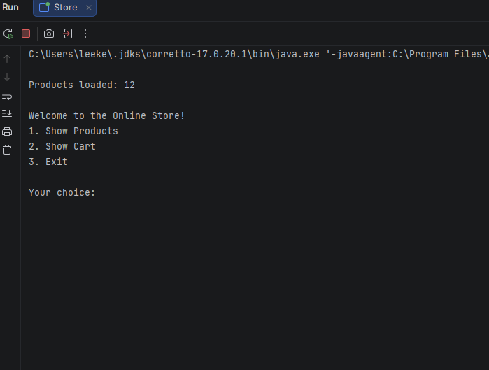
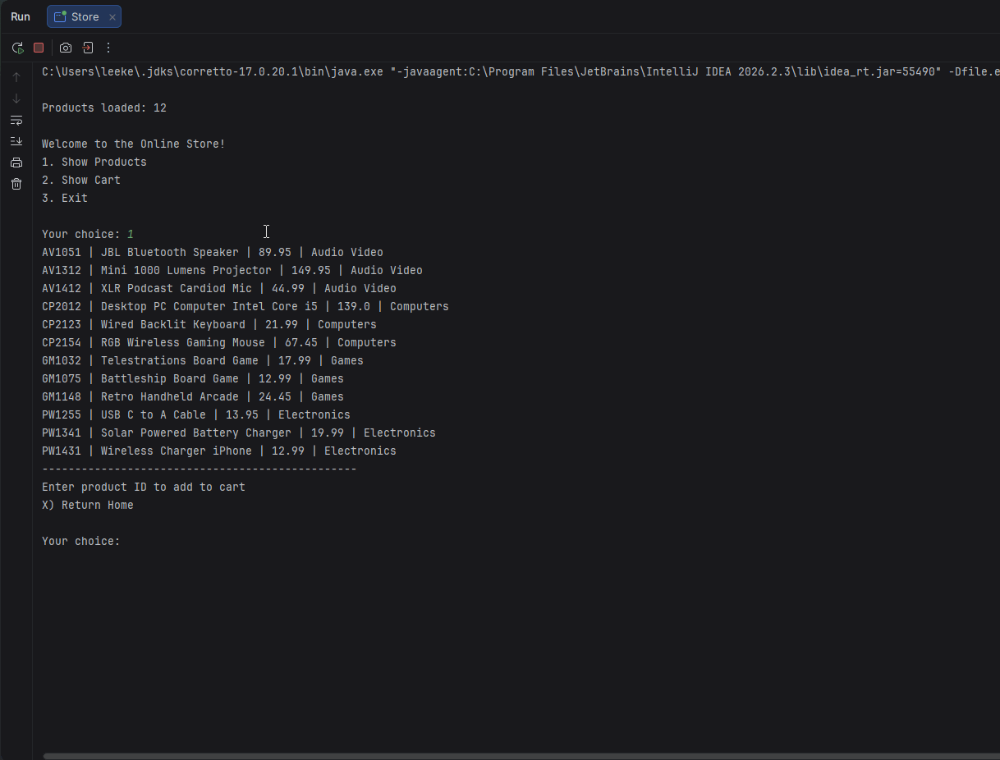
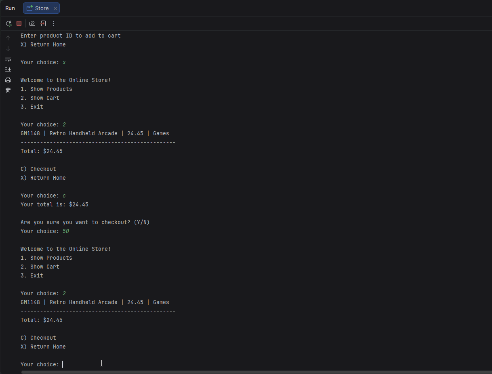

# Waltatoo Online Store

- An online store that customers can use to search products, add products, and checkout products.

## Description of the Project

- This application is an online store for customers to view products from a csv file.
- Customers will be able to control the application to search products and add them to check out.

## Features

- Shows every product in the store.
- Add product ID to cart.
- Shows customers selected cart items.
- Customer can add payment and checkout selected item or items.

## User Stories

- As a customer, I want to view all available products, so that I can see what the store has for sale.
- As a customer, I want to search for a product by its ID, so that I can find the product I want to purchase.
- As a customer, I want to add products to my cart, so that I can keep track of the items I want to purchase.
- As a customer, I want to view the items in my shopping cart, so that I can check my items before checking out.
- As a customer, I want to check out and pay for my items, so that I can check out my order.
- As a customer, I want to receive a receipt after checkout, so that I have a record of my purchase.
- As a user, I want an Informational README, so that I can understand the application's purpose, features, and how to run it.

## Setup

### Prerequisites

- Java 17 (Amazon Corretto), the version used in class.
- IntelliJ IDEA Community Edition: <https://www.jetbrains.com/idea/download/>

### Running the application

1. Clone this repository, or download it as a zip and unzip it.
2. In IntelliJ: File > Open, pick the project folder (the one that holds `pom.xml`), press Open.
3. Wait for IntelliJ to finish indexing (progress bar at the bottom).
4. Open `src/main/java/com/pluralsight/YourMainClassName.java`. <!-- replace YourMainClassName with the class that has main -->
5. Right-click inside the file and choose Run 'YourMainClassName.main()'.

### Data and configuration

- products.csv is located in the project root directory, next to pom.xml.
- The application reads products.csv when it starts and loads the product information into an ArrayList<Product>.

## Technologies Used

- Java 17
- IntelliJ IDEA

## Demo

**Main Menu**



**Add Product to Cart**



**check out Product**



## A piece of code I am proud of

- I am proud of this code because it allows the user to view the available products and add items to their 
  shopping cart. It uses a loop to display products loaded from the CSV file and prompts 
  the user to enter a product ID or return to the home screen. I used the findProductById() 
  method to locate the selected product and, if it exists, add it to the cart using an ArrayList<Product>.

```     
   boolean shopping = true;
        while (shopping) {


            for (Product product : inventory) {
                System.out.println(product.getSku() + " | " + product.getProductName() + " | " + product.getPrice() + " | " + product.getDepartment());
            }
            System.out.println("------------------------------------------------");
            System.out.println("Enter product ID to add to cart");
            System.out.println("X) Return Home ");
            System.out.println();
            System.out.print("Your choice: ");
            String productId = myScanner.nextLine();

            if (productId.equalsIgnoreCase("X")) {
                return;
            }

            Product product = findProductById(productId, inventory);

            if (product != null) {
                cart.add(product);
                System.out.println("\u001B[32m" + "[" + product.getSku() + "]" + " Was added to the cart!" + "\u001B[0m");
                System.out.println("------------------------------------------------");
            }
        }
    }

```

## Future Work

- I would do the bonus so I can get experience on how to add quantities
- I would improve the overall code to not crash and fix many more bugs that may show up
- I would make the console more visually appealing

## Resources

- Java YearUp Fall 2026 hub: <https://raymaroun.github.io/yearup-java-fall2026/>
- https://raymaroun.github.io/yearup-java-fall2026/week-03/exercises/online-store.html

## Author

- **Maalik McCutchen**

## Thanks

- Thank you to Raymond for providing the starter code to us and giving us so many resources to complete our projects.